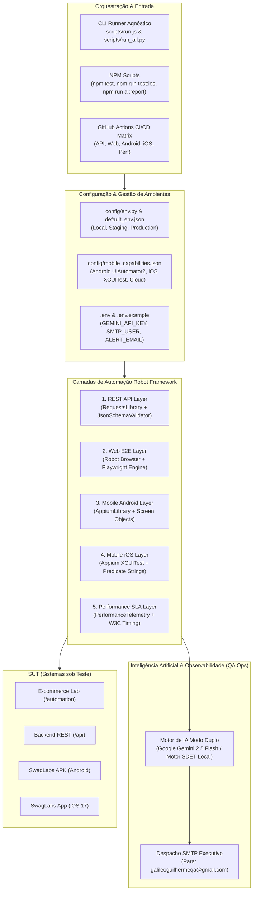

<p align="center">
  
</p>

<h1 align="center">Robot Framework QA Lab 🤖⚡</h1>

<p align="center">
  <b>Autonomous Enterprise Full-Stack Test Automation & AI Quality Engineering Lab</b><br/>
  <i>Modern Web E2E (Playwright) • REST API (OpenAPI 3.0.3) • Mobile (Android & iOS XCUITest) • Performance SLA • Gemini AI Engine</i>
</p>

<p align="center">
  <a href="https://github.com/GalileoGuilherme/robot-qa-lab/actions"></a>
  <a href="https://robotframework.org/"></a>
  <a href="https://deepmind.google/technologies/gemini/"></a>
  <a href="https://playwright.dev/"></a>
  <a href="https://appium.io/"></a>
  <a href="https://portfolio-omega-six-18.vercel.app/api-docs"></a>
  <a href="mailto:galileoguilhermeqa@gmail.com"></a>
  
  <a href="LICENSE"></a>
</p>

---

## 📑 Índice

- [Visão Geral](#-visão-geral)
- [Diagrama de Arquitetura](#-diagrama-de-arquitetura)
- [Destaques de Engenharia & Inovações](#-destaques-de-engenharia--inovações)
- [Integração com IA (Google Gemini 2.5 Flash & Motor Local SDET)](#-integração-com-ia-google-gemini-25-flash--motor-local-sdet)
- [Relatórios Executivos em HTML & Disparo por E-mail (SMTP)](#-relatórios-executivos-em-html--disparo-por-e-mail-smtp)
- [Mobile Quality Engineering (Android & iOS XCUITest)](#-mobile-quality-engineering-android--ios-xcuitest)
- [Matriz Completa de Cobertura de Testes (44 Cenários)](#-matriz-completa-de-cobertura-de-testes-44-cenários)
- [Estrutura do Projeto](#-estrutura-do-projeto)
- [Pré-requisitos](#-pré-requisitos)
- [Instalação e Setup Rápido](#-instalação-e-setup-rápido)
- [Como Executar os Testes](#-como-executar-os-testes)
- [Scripts NPM Disponíveis](#-scripts-npm-disponíveis)
- [Telemetria de Performance & Orçamentos de SLA](#-telemetria-de-performance--orçamentos-de-sla)
- [Pipeline de CI/CD (GitHub Actions Matrix)](#-pipeline-de-cicd-github-actions-matrix)
- [Autor](#-autor)

---

## 🎯 Visão Geral

O **Robot Framework QA Lab** é um ecossistema corporativo completo de **Engenharia de Qualidade Autônoma (QA Ops / SDET)**, concebido para demonstrar a vanguarda da automação de testes modernos com o **Robot Framework 7.5+**.

O projeto exercita em profundidade a aplicação web pública e seus serviços de backend em produção:
- 🌐 **Aplicação Web sob Teste:** [https://portfolio-omega-six-18.vercel.app/](https://portfolio-omega-six-18.vercel.app/)
- 🛒 **Laboratório E-commerce E2E:** [https://portfolio-omega-six-18.vercel.app/automation](https://portfolio-omega-six-18.vercel.app/automation)
- 🔌 **API REST de Produção:** [https://portfolio-omega-six-18.vercel.app/api](https://portfolio-omega-six-18.vercel.app/api)
- 📖 **Contrato Swagger OpenAPI 3.0.3:** [https://portfolio-omega-six-18.vercel.app/api-docs](https://portfolio-omega-six-18.vercel.app/api-docs)

Diferente de abordagens tradicionais, este projeto implementa uma **Arquitetura Full-Stack 5D**:
1. **Web E2E de Alta Velocidade:** impulsionado pelo motor **Playwright** via `robotframework-browser`, garantindo isolamento total de contextos e auto-waiting nativo.
2. **Backend REST API com Validação de Contrato:** verificação estrita de contratos OpenAPI 3.0.3, autenticação JWT, cupons dinâmicos, frete e integridade de dados via `RequestsLibrary` e `JsonSchemaValidator`.
3. **Engenharia Mobile Multiplataforma (Android & iOS Nativo):** Screen Object Model para **Android (`UiAutomator2`)** e **iOS (`XCUITest`)**, somado à emulação de toque e auditoria de ergonomia **WCAG 2.2 (mínimo de 44x44px)**.
4. **Telemetria de Performance & Orçamentos de SLA:** benchmarking de latência de endpoints (**P95 < 900ms**), orçamentos de payload e métricas W3C (**TTFB, DOM Interactive e Load Event**).
5. **Observabilidade Autônoma com IA & Disparo SMTP:** motor de análise preditiva em modo duplo (**Google Gemini 2.5 Flash** + contingência local autônoma) com geração e disparo de relatórios executivos em HTML escuro para `galileoguilhermeqa@gmail.com`.

---

## 🏗️ Diagrama de Arquitetura



---

## 🤖 Integração com IA (Google Gemini 2.5 Flash & Motor Local SDET)

Inspirado na arquitetura autônoma do [portfolio-qa-automation](https://github.com/GalileoGuilherme/portfolio-qa-automation.git), o módulo `scripts/ai_qa_observer.py` e a biblioteca `libraries/AiQualityObserver.py` implementam um **Observador de Qualidade Autônomo com Operação em Modo Duplo (Dual-Mode Contingency)**:

1. **Modo Google Gemini (Quando `GEMINI_API_KEY` está ativa):**
   - Conecta-se à API oficial do Google Gemini (`gemini-2.5-flash`).
   - Analisa o arquivo `results/output.xml`, tempos de resposta e saúde do backend.
   - Gera um parecer técnico executivo de SDET em 3 tópicos: integridade funcional dos fluxos, telemetria de SLA/W3C e ergonomia de toque mobile.

2. **Modo Motor Analítico SDET Local (Contingência Silenciosa / Zero Falhas):**
   - Caso a chave de API esteja ausente, com cota esgotada ou offline, o sistema **NUNCA interrompe a esteira nem expõe erros técnicos de IA**.
   - O motor analítico embutido assume silenciosamente e gera os pareceres técnicos com dados contextuais da execução, mantendo a experiência do relatório 100% íntegra.

---

## 📧 Relatórios Executivos em HTML & Disparo por E-mail (SMTP)

Após a execução dos testes, o sistema compila automaticamente o template executivo escuro em `results/executive_email_report.html`:

- **Design Corporativo Escuro:** tipografia refinada, layout responsivo para desktop e mobile, cartões de KPIs (Total, Aprovados, Ignorados, Taxa de Êxito).
- **Parecer Autônomo da IA:** bloco dedicado com a análise técnica do Google Gemini / SDET Local.
- **Tabela de Status das Suítes:** detalhamento individual do status de cada camada testada.
- **Botões Rápidos (1-Click Actions):** links diretos para re-disparar a esteira no GitHub Actions, abrir a Loja de Automação e inspecionar a documentação Swagger OpenAPI.
- **Disparo Automático via SMTP:** configurado para despachar para `galileoguilhermeqa@gmail.com` via Gmail SMTP ou provedor corporativo.

```bash
# Gerar e visualizar o relatório de e-mail no navegador:
npm run ai:report
# No Windows:
start results/executive_email_report.html
```

---

## 🍎 Mobile Quality Engineering (Android & iOS XCUITest)

A esteira mobile contempla suporte a dispositivos **Android** e **iOS** de forma nativa e padronizada:

### 1. Suíte Nativa iOS (`tests/mobile/test_mobile_ios.robot`)
- **Engine XCUITest:** executado contra o aplicativo de demonstração SwagLabs no **iPhone 15 Pro (iOS 17.2)**.
- **Seletores Avançados do iOS:** uso de **iOS Predicate Strings** (`predicate=name == 'test-Username'`) e **iOS Class Chains** (`class_chain=**/XCUIElementTypeStaticText`), garantindo máxima estabilidade e performance no ecossistema Apple.
- **Screen Object Pattern:** abstração limpa em `resources/mobile/screens/ios_swaglabs_screens.resource`.

### 2. Suíte Nativa Android (`tests/mobile/test_mobile_appium.robot`)
- **Engine UiAutomator2:** executado no Android Emulator (Android 14) com `appPackage` e `appActivity`.
- **Screen Object Pattern:** abstração em `resources/mobile/screens/swaglabs_*.resource`.

### 3. Resiliência de Infraestrutura (Graceful Skip)
Em máquinas sem emulador ou simulador local rodando, os testes nativos detectam que o servidor Appium está offline e marcam o status como `SKIP` explicativo, garantindo que qualquer desenvolvedor clone o repositório e execute a suíte sem quebras.

---

## 📊 Matriz Completa de Cobertura de Testes (44 Cenários)

| # | Camada | Suíte / Arquivo | Cenário de Teste | Tags | Validação / SLA |
|:---:|:---:|:---|:---|:---:|:---:|
| **01** | `API` | `test_health.robot` | Healthcheck retorna status UP e contrato válido | `smoke`, `contract` | Schema OpenAPI 3.0.3 |
| **02** | `API` | `test_health.robot` | Healthcheck cumpre SLA de latência | `sla`, `performance` | `< 800 ms` |
| **03** | `API` | `test_health.robot` | Serviço responde com cabeçalho application/json | `headers` | `Content-Type` |
| **04** | `API` | `test_products.robot` | Obter catálogo completo e validar contrato OpenAPI | `smoke`, `contract` | Schema Listagem |
| **05** | `API` | `test_products.robot` | Filtrar produtos pela categoria 'Eletrônicos' | `filter` | Filtro de Categoria |
| **06** | `API` | `test_products.robot` | Filtrar produtos pela categoria 'Casa' | `filter` | Filtro de Categoria |
| **07** | `API` | `test_products.robot` | Integridade de dados de negócio (estoque, preço, rating) | `integrity`, `regression` | Preço > 0, Rating 0-5 |
| **08** | `API` | `test_products.robot` | Catálogo de produtos cumpre SLA de latência | `sla`, `performance` | `< 1000 ms` |
| **09** | `API` | `test_orders.robot` | Criar pedido válido e validar contrato OpenAPI (HTTP 201) | `smoke`, `critical` | `status: CONFIRMED` |
| **10** | `API` | `test_orders.robot` | Rejeitar pedido com lista de itens vazia (HTTP 400) | `negative`, `validation` | Mensagem de Erro |
| **11** | `API` | `test_orders.robot` | Serviço de pedidos cumpre SLA de latência | `sla`, `performance` | `< 1200 ms` |
| **12** | `API` | `test_auth_and_checkout_services.robot` | Autenticar usuário demo e gerar Token JWT | `auth`, `critical` | JWT Token + User Role |
| **13** | `API` | `test_auth_and_checkout_services.robot` | Validar cupom promocional CYPRESS10 (10% desconto) | `coupons`, `business-rules` | `valid: true`, `10%` |
| **14** | `API` | `test_auth_and_checkout_services.robot` | Rejeitar cupom inexistente com erro HTTP 400 | `coupons`, `negative` | Erro amigável |
| **15** | `API` | `test_auth_and_checkout_services.robot` | Calcular cotações de frete para CEP válido | `shipping`, `business-rules` | Padrão grátis + Expressa |
| **16** | `WEB` | `test_catalog_and_search.robot` | Autenticar na loja demo e verificar catálogo completo | `smoke`, `critical` | >= 6 produtos |
| **17** | `WEB` | `test_catalog_and_search.robot` | Buscar produto com debounce em tempo real | `search` | Exibição de 1 item |
| **18** | `WEB` | `test_catalog_and_search.robot` | Busca por termo inexistente exibe estado vazio | `search`, `empty-state` | `#qa-products-empty` |
| **19** | `WEB` | `test_catalog_and_search.robot` | Filtrar produtos por categoria | `filter` | 2 itens de 'Casa' |
| **20** | `WEB` | `test_catalog_and_search.robot` | Ordenar catálogo por preço crescente e decrescente | `sorting` | Verificação de IDs |
| **21** | `WEB` | `test_cart_and_checkout.robot` | Adicionar produto ao carrinho e verificar contador | `cart`, `smoke` | Contador + Feedback |
| **22** | `WEB` | `test_cart_and_checkout.robot` | Alterar quantidade do produto no carrinho | `cart`, `quantity` | Subtotal recalculado |
| **23** | `WEB` | `test_cart_and_checkout.robot` | Aplicar cupom de desconto válido CYPRESS10 | `promo`, `coupon` | Desconto visível |
| **24** | `WEB` | `test_cart_and_checkout.robot` | Remover produto e validar estado de carrinho vazio | `cart`, `empty` | `#qa-cart-empty` |
| **25** | `WEB` | `test_cart_and_checkout.robot` | Validar obrigatoriedade de campos no checkout | `checkout`, `validation` | Botão desabilitado |
| **26** | `WEB` | `test_cart_and_checkout.robot` | Concluir checkout E2E completo com confirmação de pedido | `checkout`, `critical` | Gerado `QA-XXXXXX` |
| **27** | `WEB` | `test_responsive_matrix.robot` | Ergonomia de layout em Viewport Desktop (1280x800) | `desktop` | Zero overflow horizontal |
| **28** | `WEB` | `test_responsive_matrix.robot` | Ergonomia de layout em Viewport Tablet (768x1024 - iPad) | `tablet` | Quebra harmônica |
| **29** | `WEB` | `test_responsive_matrix.robot` | Ergonomia de layout em Viewport Mobile (390x844 - iPhone) | `mobile-web`, `touch` | Zero overflow horizontal |
| **30** | `PERF` | `test_api_sla_benchmarks.robot` | Benchmark estatístico de latência do /api/health | `critical`, `p95` | `P95 < 900 ms` |
| **31** | `PERF` | `test_api_sla_benchmarks.robot` | Benchmark estatístico de latência do /api/products | `catalog`, `p95` | `P95 < 1200 ms` |
| **32** | `PERF` | `test_api_sla_benchmarks.robot` | Verificação de estabilidade de throughput e jitter | `jitter`, `stability` | Baixa dispersão |
| **33** | `PERF` | `test_api_sla_benchmarks.robot` | Validação de orçamento de tamanho de payload | `payload`, `budget` | `< 100 KB` |
| **34** | `PERF` | `test_web_performance.robot` | Auditoria W3C Navigation Timing na Home Page | `critical`, `cwv` | `TTFB < 800ms`, `DOM < 2.5s` |
| **35** | `PERF` | `test_web_performance.robot` | Auditoria W3C Navigation Timing na Loja de Automação | `store`, `cwv` | `DOM Interactive < 2.5s` |
| **36** | `MOBILE` | `test_mobile_appium.robot` | Login Mobile Android com usuário padrão (SwagLabs) | `mobile`, `native` | Screen Object Model |
| **37** | `MOBILE` | `test_mobile_appium.robot` | Validação de erro em usuário bloqueado no Android | `mobile`, `negative` | Banner nativo UiAutomator2 |
| **38** | `MOBILE` | `test_mobile_appium.robot` | Fluxo Android de adição ao carrinho e checkout | `mobile`, `checkout` | Gestos & Digitação |
| **39** | `MOBILE` | `test_mobile_ios.robot` | Login Mobile iOS com usuário padrão (iPhone 15 Pro) | `mobile`, `ios`, `smoke` | XCUITest Predicates |
| **40** | `MOBILE` | `test_mobile_ios.robot` | Validação de erro em usuário bloqueado no iOS | `mobile`, `ios`, `negative` | Banner nativo XCUITest |
| **41** | `MOBILE` | `test_mobile_ios.robot` | Fluxo iOS de adição de item ao carrinho e checkout | `mobile`, `ios`, `checkout` | Screen Objects iOS |
| **42** | `MOBILE` | `test_mobile_web_touch.robot` | Autenticação e navegação por toque em Viewport Mobile | `mobile-web`, `touch` | Eventos touch nativos |
| **43** | `MOBILE` | `test_mobile_web_touch.robot` | Gestão de quantidade no carrinho via toque mobile | `touch`, `cart` | Interação touch |
| **44** | `MOBILE` | `test_mobile_web_touch.robot` | Auditoria WCAG 2.2 de dimensão mínima de toque (>= 44px) | `accessibility`, `wcag` | Alvos de toque ergonômicos |

---

## 📁 Estrutura do Projeto

```
robot-qa-lab/
├── .env.example                           # Modelo de variáveis de ambiente (IA e SMTP)
├── .github/
│   └── workflows/
│       ├── robot-pipeline.yml             # Pipeline CI/CD matriz (API, Web, Mobile, Perf)
│       └── pr-smoke.yml                   # Validação rápida de PR (@smoke)
├── .vscode/
│   ├── settings.json                      # Configurações do Robot Language Server
│   └── extensions.json                    # Extensões recomendadas para VS Code
├── config/
│   ├── default_env.json                   # URLs base, timeouts e limites de SLA
│   ├── env.py                             # Carregador dinâmico de variáveis por ambiente
│   └── mobile_capabilities.json           # Matriz de capabilities Appium (Android/iOS/Cloud)
├── data/
│   ├── fixtures/
│   │   ├── users.json                     # Credenciais e perfis de teste
│   │   ├── order_samples.json             # Payloads de checkout e cupons
│   │   └── contact_samples.json           # Exemplos de formulários e segurança
│   └── schemas/
│       ├── health_schema.json             # Schema OpenAPI 3.0 do /api/health
│       ├── products_schema.json           # Schema OpenAPI 3.0 do /api/products
│       ├── orders_schema.json             # Schema OpenAPI 3.0 do /api/orders
│       ├── auth_schema.json               # Schema OpenAPI 3.0 do /api/auth/login
│       ├── coupon_schema.json             # Schema de validação de cupons
│       └── shipping_schema.json           # Schema de cotação de frete
├── libraries/
│   ├── AiQualityObserver.py               # Biblioteca Robot Framework para telemetria com IA
│   ├── JsonSchemaValidator.py             # Validador de esquemas JSON Draft-07 com diff amigável
│   ├── PerformanceTelemetry.py            # Benchmarking de API (P95) e W3C Navigation Timing
│   ├── MobileGestures.py                  # Gestos touch (swipe percentual, scroll até visível)
│   └── ReportEnhancer.py                  # Injetor de metadados de telemetria no relatório
├── resources/
│   ├── base.resource                      # Hooks globais, setup e teardown de suítes
│   ├── api/                               # Keywords e clientes HTTP de API REST
│   ├── web/                               # Page Objects Web E2E (Playwright)
│   ├── mobile/
│   │   ├── mobile_common.resource         # Sessões Appium Android e iOS XCUITest
│   │   └── screens/
│   │       ├── swaglabs_login_screen.resource    # Screen Object Android Login
│   │       ├── swaglabs_catalog_screen.resource  # Screen Object Android Catálogo
│   │       ├── swaglabs_checkout_screen.resource # Screen Object Android Checkout
│   │       └── ios_swaglabs_screens.resource     # Screen Objects iOS (iPhone 15 Pro)
│   └── performance/                       # Keywords de benchmarks de SLA e Core Web Vitals
├── tests/
│   ├── api/                               # 15 Testes Backend REST API
│   ├── web/                               # 14 Testes E2E Web (Playwright)
│   ├── mobile/                            # 9 Testes Mobile (Android, iOS e Touch)
│   │   ├── test_mobile_appium.robot       # Testes Android Nativo
│   │   ├── test_mobile_ios.robot          # Testes iOS Nativo (XCUITest)
│   │   └── test_mobile_web_touch.robot    # Testes Touch e WCAG 2.2
│   └── performance/                       # 6 Testes de SLA e Orçamentos
├── scripts/
│   ├── run.js                             # Runner agnóstico multiplataforma (Git Bash, CMD, PS, Unix)
│   ├── run_all.py                         # CLI Runner Python com filtros de camadas e tags
│   ├── ai_qa_observer.py                  # Observador Autônomo com Gemini e Gerador de E-mail
│   ├── generate_metrics.py                # Gerador do Dashboard Visual robotframework-metrics
│   └── check_env.py                       # Diagnóstico automatizado de ambiente e ferramentas
├── package.json                           # Scripts NPM expressos para desenvolvimento ágil
├── pyproject.toml                         # Configuração e metadados de dependências Python
├── requirements.txt                       # Dependências pip convencionais
└── README.md                              # Documentação de excelência do projeto
```

---

## 💻 Pré-requisitos

- **Python:** 3.10, 3.11 ou 3.12 LTS.
- **Node.js:** 18+ ou 20+ LTS (utilizado pelos binários de browser do Playwright e runner agnóstico).
- **Gerenciador de Pacotes Python:** `uv` (recomendado ~15s) ou `pip`.

---

## ⚡ Instalação e Setup Rápido

```bash
# 1. Clone o repositório
git clone https://github.com/GalileoGuilherme/robot-qa-lab.git
cd robot-qa-lab

# 2. Crie e ative o ambiente virtual Python 3.12
uv venv .venv --python 3.12
# No Windows (Git Bash):
source .venv/Scripts/activate
# No Windows (PowerShell):
.venv\Scripts\activate

# 3. Instale as dependências
uv pip install -r requirements.txt

# 4. Inicialize os binários dos navegadores Playwright
rfbrowser init

# 5. Configure variáveis de ambiente opcionais (IA e SMTP)
cp .env.example .env

# 6. Valide o ambiente
npm run check-env
```

---

## 📦 Scripts NPM Disponíveis

O `package.json` disponibiliza comandos de um clique via Node.js agnóstico, funcionando sem atritos em qualquer terminal (Git Bash, PowerShell, Linux ou macOS):

| Comando | Descrição |
|:---|:---|
| `npm test` | Executa a suíte completa (44 cenários), gera métricas e parecer da IA |
| `npm run test:api` | Executa exclusivamente a camada de API REST (15 testes) |
| `npm run test:web` | Executa a camada Web E2E em modo headless (14 testes) |
| `npm run test:headed` | Executa a camada Web E2E com navegador visível |
| `npm run test:mobile` | Executa a camada Mobile Android e Touch Viewports |
| `npm run test:ios` | Executa a camada Mobile iOS nativa (XCUITest no iPhone 15 Pro) |
| `npm run test:perf` | Executa os benchmarks estatísticos e orçamentos de SLA |
| `npm run test:smoke` | Executa a validação rápida com a tag `@smoke` |
| `npm run ai:report` | Compila o Parecer de IA e gera o Relatório de E-mail Executivo |
| `npm run send:email` | Dispara o relatório de e-mail executivo para `galileoguilhermeqa@gmail.com` |
| `npm run report:metrics` | Regenera o Dashboard HTML executivo a partir do `output.xml` |
| `npm run check-env` | Executa diagnóstico do ambiente local (Python, Node, Appium) |

---

## 📈 Relatórios Executivos e Dashboards

Ao final de cada execução, 4 relatórios complementares são gerados no diretório `results/`:

1. **`executive_email_report.html` (Template Escuro de E-mail):** layout corporativo de observabilidade com parecer da IA, taxas de êxito e botões de ação rápida.
2. **`metrics.html` (Dashboard Visual Interativo):** gráficos de pizza, linha do tempo de execução, ranking de keywords mais lentas e taxas de sucesso gerado por `robotframework-metrics`.
3. **`report.html` (Robot Framework Nativo):** visão geral executiva oficial.
4. **`log.html` (Robot Framework Rastreabilidade):** logs detalhados, payloads de API, requisições de rede e tempos individuais de cada palavra-chave.

```bash
# Para visualizar no navegador:
start results/executive_email_report.html
start results/metrics.html
start results/log.html
```

---

## 🔄 Pipeline de CI/CD (GitHub Actions Matrix)

O pipeline em `.github/workflows/robot-pipeline.yml` valida continuamente cada alteração enviada ao repositório através de uma **matriz de execução paralela**:

- **Ambiente Isolado:** Ubuntu Latest com Python 3.12 e Node.js 20.
- **Jobs Paralelos:**
  - `Run api Tests`
  - `Run web Tests`
  - `Run mobile Tests`
  - `Run performance Tests`
- **Artefatos Automatizados:** publicação de `log.html`, `report.html`, `metrics.html` e `executive_email_report.html` disponíveis para download por até 14 dias em cada pull request e push na branch principal.

---

## 👤 Autor

Desenvolvido com excelência técnica por **Galileo Guilherme**, QA Engineer & Especialista em Automação de Testes de Software.

- 💼 **LinkedIn:** [Galileo Guilherme](https://www.linkedin.com/in/galileoguilherme/)
- 🐙 **GitHub:** [@GalileoGuilherme](https://github.com/GalileoGuilherme)
- 🌐 **Portfólio & Laboratório:** [portfolio-omega-six-18.vercel.app](https://portfolio-omega-six-18.vercel.app/)

---

<p align="center">
  <i>Construído para elevar o padrão da Engenharia de Qualidade de Software através de automação moderna, mobile nativo e observabilidade por IA.</i>
</p>
