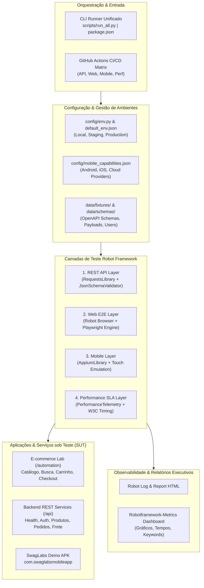

<p align="center">
  
</p>

<h1 align="center">Robot Framework QA Lab 🤖⚡</h1>

<p align="center">
  <b>Enterprise Full-Stack Test Automation & Quality Engineering Lab</b><br/>
  <i>Modern Web E2E (Playwright) • REST API (OpenAPI 3.0.3) • Mobile (Appium 2.x & Touch) • Performance SLA Telemetry</i>
</p>

<p align="center">
  <a href="https://github.com/GalileoGuilherme/robot-qa-lab/actions"></a>
  <a href="https://robotframework.org/"></a>
  <a href="https://playwright.dev/"></a>
  <a href="https://appium.io/"></a>
  <a href="https://www.python.org/"></a>
  <a href="https://portfolio-omega-six-18.vercel.app/api-docs"></a>
  
  <a href="LICENSE"></a>
</p>

---

## 📑 Índice

- [Visão Geral](#-visão-geral)
- [Diagrama de Arquitetura](#-diagrama-de-arquitetura)
- [Destaques de Engenharia & Inovações](#-destaques-de-engenharia--inovações)
- [Matriz Completa de Cobertura de Testes (41 Cenários)](#-matriz-completa-de-cobertura-de-testes-41-cenários)
- [Estrutura do Projeto](#-estrutura-do-projeto)
- [Pré-requisitos](#-pré-requisitos)
- [Instalação e Setup Rápido](#-instalação-e-setup-rápido)
- [Como Executar os Testes](#-como-executar-os-testes)
- [Scripts NPM Disponíveis](#-scripts-npm-disponíveis)
- [Mobile Quality Engineering (Appium 2.x & Touch)](#-mobile-quality-engineering-appium-2x--touch)
- [Telemetria de Performance & Orçamentos de SLA](#-telemetria-de-performance--orçamentos-de-sla)
- [Relatórios Executivos e Dashboards](#-relatórios-executivos-e-dashboards)
- [Pipeline de CI/CD (GitHub Actions Matrix)](#-pipeline-de-cicd-github-actions-matrix)
- [Autor](#-autor)

---

## 🎯 Visão Geral

O **Robot Framework QA Lab** é um ecossistema completo de **Engenharia de Qualidade de Software (SDET / QA Ops)** de nível corporativo, concebido para demonstrar todo o poder, modularidade e expressividade do **Robot Framework** moderno.

O projeto exercita em profundidade a aplicação web pública e seus serviços backend de alta performance disponíveis em:
- 🌐 **Aplicação Web sob Teste:** [https://portfolio-omega-six-18.vercel.app/](https://portfolio-omega-six-18.vercel.app/)
- 🛒 **Laboratório E-commerce E2E:** [https://portfolio-omega-six-18.vercel.app/automation](https://portfolio-omega-six-18.vercel.app/automation)
- 🔌 **API REST de Produção:** [https://portfolio-omega-six-18.vercel.app/api](https://portfolio-omega-six-18.vercel.app/api)
- 📖 **Contrato Swagger OpenAPI 3.0.3:** [https://portfolio-omega-six-18.vercel.app/api-docs](https://portfolio-omega-six-18.vercel.app/api-docs)

Diferente de projetos acadêmicos ou limitados a testes superficiais de Selenium, este laboratório implementa uma **arquitetura de testes quadridimensional (Full-Stack 4D Testing)**:
1. **Web E2E de Alta Velocidade:** impulsionado pelo motor **Playwright** via `robotframework-browser`, garantindo isolamento total de contextos, auto-waiting inteligente e eliminação completa de seletores frágeis (*flaky tests*).
2. **Backend REST API com Validação de Contrato:** testes de autenticação JWT, cupons dinâmicos, frete e checkout contra schemas estritos **OpenAPI 3.0.3 / JSON Schema Draft-07**.
3. **Engenharia Mobile Nativa & Touch Viewport:** arquitetura **Screen Object Model** para automação de aplicativos nativos Android/iOS via **Appium 2.x** (`UiAutomator2` / `XCUITest`), somada a validações touch responsivas e auditoria de alvos de toque **WCAG 2.2 (mínimo de 44x44px)**.
4. **Telemetria Contínua de Performance & SLA:** auditoria em tempo real de latência de endpoints (médias, jitter e **P95 < 900ms**), orçamentos de payload e métricas W3C de carregamento de página (**TTFB, DOM Interactive e Load Event**).

---

## 🏗️ Diagrama de Arquitetura



---

## 🌟 Destaques de Engenharia & Inovações

### 1. 🚀 Playwright sob Robot Framework (`Browser Library`)
Abandonando os antigos problemas de sincronização do Selenium clássico, a suíte utiliza a `Browser Library` oficial baseada no motor **Playwright**:
- **Strict-Mode Heuristics:** prevenção ativa contra colisões de múltiplos elementos no DOM.
- **Auto-Waiting Nativo:** espera inteligente de mutações de DOM, requisições de rede e renderização sem necessidade de `sleep` arbitrário.
- **Emulação Real de Dispositivos Móveis:** criação dinâmica de contextos com `isMobile=True`, capacidades de toque (`hasTouch=True`) e user-agents customizados (iPhone 14, Pixel 7).

### 2. 🛡️ Validação Estrita de Contrato OpenAPI 3.0.3 & JSON Schema
- Implementação de biblioteca customizada em Python (`libraries/JsonSchemaValidator.py`) encapsulando o validador `Draft7Validator`.
- Toda resposta de API passa por validação rigorosa de tipos, campos obrigatórios, enums, padrões regex (ex: `^ORD-[0-9]+$`) e formatos de data-hora ISO-8601, detectando quebras de contrato antes que atinjam a produção.

### 3. 📱 Arquitetura Mobile Multiplataforma (Appium 2.x & Screen Object Model)
- **Screen Object Pattern:** abstração limpa de telas nativas (`swaglabs_login_screen.resource`, `swaglabs_catalog_screen.resource`, `swaglabs_checkout_screen.resource`).
- **Resiliência de Infraestrutura (Graceful Skip):** o executor detecta autonomamente se o nó local do Appium está ativo (`/status`). Em ambientes de desenvolvimento sem emulador rodando, os testes nativos são sinalizados elegantemente como `SKIP`, mantendo o pipeline verde e executável em qualquer máquina.
- **Auditoria de Acessibilidade Mobile WCAG 2.2:** extração do *bounding box* de botões e campos de busca touch para garantir área mínima de clique confortável (>= 44x44px).

### 4. ⚡ Telemetria de Performance Leve & SLA Percentílico (P95)
- **Benchmarking Estatístico de Endpoints:** medição multi-iteração com timer de alta resolução (`time.perf_counter()`), calculando distribuição de latências: Mínima, Média, Mediana (P50), P90, **P95** e Máxima.
- **Asserção de Orçamentos de SLA:** falha automática da esteira caso o percentil 95 ultrapasse o orçamento estipulado (ex: P95 > 900ms).
- **Auditoria W3C Navigation Timing API:** injeção de JavaScript para telemetria de renderização real no navegador:
  - `TTFB (Time to First Byte)`
  - `DOM Interactive Time`
  - `DOM Content Loaded`
  - `Full Load Event Time`

### 5. 📊 Orquestrador Unificado & Dashboard Executivo (`robotframework-metrics`)
- Script CLI proprietário `scripts/run_all.py` permitindo chaveamento instantâneo de camadas (`--layer api|web|mobile|performance|smoke`), navegadores (`--browser chromium|firefox|webkit`), ambientes (`--env production|staging|local`) e modo headless/headed.
- Geração automática de painel executivo moderno `results/metrics.html` com gráficos de pizza, linha do tempo de execução, ranking de keywords mais lentas e taxas de sucesso.

---

## 📊 Matriz Completa de Cobertura de Testes (41 Cenários)

| # | Camada | Suíte / Arquivo | Cenário de Teste | Tags | SLA / Validação |
|:---:|:---:|:---|:---|:---:|:---:|
| **01** | `API` | `test_health.robot` | Healthcheck retorna status UP e contrato válido | `smoke`, `contract` | Schema OpenAPI 3.0.3 |
| **02** | `API` | `test_health.robot` | Healthcheck cumpre SLA de latência | `sla`, `performance` | `< 800 ms` |
| **03** | `API` | `test_health.robot` | Serviço responde com cabeçalho application/json | `headers` | `Content-Type` |
| **04** | `API` | `test_products.robot` | Obter catálogo completo e validar contrato OpenAPI | `smoke`, `contract` | Schema Listagem |
| **05** | `API` | `test_products.robot` | Filtrar produtos pela categoria 'Eletrônicos' | `filter` | Filtro de Categoria |
| **06** | `API` | `test_products.robot` | Filtrar produtos pela categoria 'Casa' | `filter` | Filtro de Categoria |
| **07** | `API` | `test_products.robot` | Integridade de dados de negócio (estoque, preço, rating) | `integrity`, `regression` | Preço > 0, Rating 0-5 |
| **08** | `API` | `test_products.robot` | Catálogo de produtos cumpre SLA de latência | `sla`, `performance` | `< 1000 ms` |
| **09** | `API` | `test_orders.robot` | Criar pedido válido e validar contrato OpenAPI (HTTP 201) | `smoke`, `critical` | `status: CONFIRMED` |
| **10** | `API` | `test_orders.robot` | Rejeitar pedido com lista de itens vazia (HTTP 400) | `negative`, `validation` | Mensagem de Erro |
| **11** | `API` | `test_orders.robot` | Serviço de pedidos cumpre SLA de latência | `sla`, `performance` | `< 1200 ms` |
| **12** | `API` | `test_auth_and_checkout_services.robot` | Autenticar usuário demo e gerar Token JWT | `auth`, `critical` | JWT Token + User Role |
| **13** | `API` | `test_auth_and_checkout_services.robot` | Validar cupom promocional CYPRESS10 (10% desconto) | `coupons`, `business-rules` | `valid: true`, `10%` |
| **14** | `API` | `test_auth_and_checkout_services.robot` | Rejeitar cupom inexistente com erro HTTP 400 | `coupons`, `negative` | Erro amigável |
| **15** | `API` | `test_auth_and_checkout_services.robot` | Calcular cotações de frete para CEP válido | `shipping`, `business-rules` | Padrão grátis + Expressa |
| **16** | `WEB` | `test_catalog_and_search.robot` | Autenticar na loja demo e verificar catálogo completo | `smoke`, `critical` | >= 6 produtos |
| **17** | `WEB` | `test_catalog_and_search.robot` | Buscar produto com debounce em tempo real | `search` | Exibição de 1 item |
| **18** | `WEB` | `test_catalog_and_search.robot` | Busca por termo inexistente exibe estado vazio | `search`, `empty-state` | `#qa-products-empty` |
| **19** | `WEB` | `test_catalog_and_search.robot` | Filtrar produtos por categoria | `filter` | 2 itens de 'Casa' |
| **20** | `WEB` | `test_catalog_and_search.robot` | Ordenar catálogo por preço crescente e decrescente | `sorting` | Verificação de IDs |
| **21** | `WEB` | `test_cart_and_checkout.robot` | Adicionar produto ao carrinho e verificar contador | `cart`, `smoke` | Contador + Feedback |
| **22** | `WEB` | `test_cart_and_checkout.robot` | Alterar quantidade do produto no carrinho | `cart`, `quantity` | Subtotal recalculado |
| **23** | `WEB` | `test_cart_and_checkout.robot` | Aplicar cupom de desconto válido CYPRESS10 | `promo`, `coupon` | Desconto visível |
| **24** | `WEB` | `test_cart_and_checkout.robot` | Remover produto e validar estado de carrinho vazio | `cart`, `empty` | `#qa-cart-empty` |
| **25** | `WEB` | `test_cart_and_checkout.robot` | Validar obrigatoriedade de campos no checkout | `checkout`, `validation` | Botão desabilitado |
| **26** | `WEB` | `test_cart_and_checkout.robot` | Concluir checkout E2E completo com confirmação de pedido | `checkout`, `critical` | Gerado `QA-XXXXXX` |
| **27** | `WEB` | `test_responsive_matrix.robot` | Ergonomia de layout em Viewport Desktop (1280x800) | `desktop` | Zero overflow horizontal |
| **28** | `WEB` | `test_responsive_matrix.robot` | Ergonomia de layout em Viewport Tablet (768x1024 - iPad) | `tablet` | Quebra harmônica |
| **29** | `WEB` | `test_responsive_matrix.robot` | Ergonomia de layout em Viewport Mobile (390x844 - iPhone) | `mobile-web`, `touch` | Zero overflow horizontal |
| **30** | `PERF` | `test_api_sla_benchmarks.robot` | Benchmark estatístico de latência do /api/health | `critical`, `p95` | `P95 < 900 ms` |
| **31** | `PERF` | `test_api_sla_benchmarks.robot` | Benchmark estatístico de latência do /api/products | `catalog`, `p95` | `P95 < 1200 ms` |
| **32** | `PERF` | `test_api_sla_benchmarks.robot` | Verificação de estabilidade de throughput e jitter | `jitter`, `stability` | Baixa dispersão |
| **33** | `PERF` | `test_api_sla_benchmarks.robot` | Validação de orçamento de tamanho de payload | `payload`, `budget` | `< 100 KB` |
| **34** | `PERF` | `test_web_performance.robot` | Auditoria W3C Navigation Timing na Home Page | `critical`, `cwv` | `TTFB < 800ms`, `DOM < 2.5s` |
| **35** | `PERF` | `test_web_performance.robot` | Auditoria W3C Navigation Timing na Loja de Automação | `store`, `cwv` | `DOM Interactive < 2.5s` |
| **36** | `MOBILE` | `test_mobile_appium.robot` | Login Mobile Nativo com usuário padrão (SwagLabs) | `mobile`, `native` | Screen Object Model |
| **37** | `MOBILE` | `test_mobile_appium.robot` | Validação de mensagem de erro em usuário bloqueado | `mobile`, `negative` | Banner de erro nativo |
| **38** | `MOBILE` | `test_mobile_appium.robot` | Fluxo Mobile de adição de item ao carrinho e checkout | `mobile`, `checkout` | Gestos & Digitação |
| **39** | `MOBILE` | `test_mobile_web_touch.robot` | Autenticação e navegação por toque em Viewport Mobile | `mobile-web`, `touch` | Eventos touch nativos |
| **40** | `MOBILE` | `test_mobile_web_touch.robot` | Gestão de quantidade no carrinho via toque mobile | `touch`, `cart` | Interação touch |
| **41** | `MOBILE` | `test_mobile_web_touch.robot` | Auditoria WCAG 2.2 de dimensão mínima de toque (>= 44px) | `accessibility`, `wcag` | Alvos de toque ergonômicos |

---

## 📁 Estrutura do Projeto

```
robot-qa-lab/
├── .github/
│   └── workflows/
│       ├── robot-pipeline.yml             # Pipeline CI/CD matriz (API, Web, Mobile, Perf)
│       └── pr-smoke.yml                   # Validação rápida de PR (@smoke)
├── .vscode/
│   ├── settings.json                      # Configurações do Robot Language Server
│   └── extensions.json                    # Extensões recomendadas para VS Code
├── config/
│   ├── default_env.json                   # URLs base, timeouts e limites de SLA
│   ├── env.py                             # Carregador dinâmico de variáveis por ambiente
│   └── mobile_capabilities.json           # Matriz de capabilities Appium (Android/iOS/Cloud)
├── data/
│   ├── fixtures/
│   │   ├── users.json                     # Credenciais e perfis de teste
│   │   ├── order_samples.json             # Payloads de checkout e cupons
│   │   └── contact_samples.json           # Exemplos de formulários e segurança
│   └── schemas/
│       ├── health_schema.json             # Schema OpenAPI 3.0 do /api/health
│       ├── products_schema.json           # Schema OpenAPI 3.0 do /api/products
│       ├── orders_schema.json             # Schema OpenAPI 3.0 do /api/orders
│       ├── auth_schema.json               # Schema OpenAPI 3.0 do /api/auth/login
│       ├── coupon_schema.json             # Schema de validação de cupons
│       └── shipping_schema.json           # Schema de cotação de frete
├── libraries/
│   ├── JsonSchemaValidator.py             # Validador de esquemas JSON Draft-07 com diff amigável
│   ├── PerformanceTelemetry.py            # Benchmarking de API (P95) e W3C Navigation Timing
│   ├── MobileGestures.py                  # Gestos touch (swipe percentual, scroll até visível)
│   └── ReportEnhancer.py                  # Injetor de metadados de telemetria no relatório
├── resources/
│   ├── base.resource                      # Hooks globais, setup e teardown de suítes
│   ├── api/
│   │   ├── api_common.resource            # Sessões HTTP, asserções de status e SLA
│   │   ├── health_client.resource         # Keywords do serviço /health
│   │   ├── products_client.resource       # Keywords do serviço /products
│   │   ├── orders_client.resource         # Keywords do serviço /orders
│   │   ├── auth_client.resource           # Keywords de autenticação e JWT
│   │   ├── coupons_client.resource        # Keywords de validação de cupons
│   │   └── shipping_client.resource       # Keywords de cálculo de frete
│   ├── web/
│   │   ├── web_common.resource            # Ciclo de vida do Playwright Browser e viewports
│   │   └── pages/
│   │       ├── home_page.resource         # Page Object da Home do Portfólio
│   │       ├── automation_page.resource   # Page Object do E-commerce Lab (/automation)
│   │       ├── checkout_page.resource     # Page Object de Checkout e Pedido
│   │       └── contact_page.resource      # Page Object de Contato
│   ├── mobile/
│   │   ├── mobile_common.resource         # Gerenciamento de sessão Appium com fallback limpo
│   │   └── screens/
│   │       ├── swaglabs_login_screen.resource    # Screen Object de Login Mobile
│   │       ├── swaglabs_catalog_screen.resource  # Screen Object de Catálogo Mobile
│   │       └── swaglabs_checkout_screen.resource # Screen Object de Checkout Mobile
│   └── performance/
│       └── performance_keywords.resource  # Keywords de benchmarks de SLA e Core Web Vitals
├── tests/
│   ├── api/                               # 15 Testes Automatizados de Backend REST API
│   │   ├── test_health.robot
│   │   ├── test_products.robot
│   │   ├── test_orders.robot
│   │   └── test_auth_and_checkout_services.robot
│   ├── web/                               # 14 Testes Automatizados E2E Web (Playwright)
│   │   ├── test_catalog_and_search.robot
│   │   ├── test_cart_and_checkout.robot
│   │   └── test_responsive_matrix.robot
│   ├── mobile/                            # 6 Testes Mobile (Appium Nativo + Touch Viewport)
│   │   ├── test_mobile_appium.robot
│   │   └── test_mobile_web_touch.robot
│   └── performance/                       # 6 Testes de SLA e Orçamentos de Performance
│       ├── test_api_sla_benchmarks.robot
│       └── test_web_performance.robot
├── scripts/
│   ├── run_all.py                         # CLI Runner Unificado com argumentos e filtros
│   ├── generate_metrics.py                # Gerador do Dashboard Visual robotframework-metrics
│   └── check_env.py                       # Diagnóstico automatizado de ambiente e ferramentas
├── package.json                           # Scripts NPM para execução ágil
├── pyproject.toml                         # Configuração e metadados de dependências Python
├── requirements.txt                       # Dependências pip convencionais
└── README.md                              # Documentação de excelência do projeto
```

---

## 💻 Pré-requisitos

- **Python:** 3.10, 3.11 ou 3.12 LTS.
- **Node.js:** 18+ ou 20+ LTS (necessário para os binários de browser do Playwright).
- **Gerenciador de Pacotes Python:** `uv` (altamente recomendado pela velocidade) ou `pip`.

---

## ⚡ Instalação e Setup Rápido

### Opção 1: Setup Ultra-Rápido com `uv` (Recomendado ~15 segundos)

```bash
# 1. Clone o repositório
git clone https://github.com/GalileoGuilherme/robot-qa-lab.git
cd robot-qa-lab

# 2. Crie e ative o ambiente virtual Python 3.12
uv venv .venv --python 3.12
# No Windows:
.venv\Scripts\activate
# No Linux/macOS:
source .venv/bin/activate

# 3. Instale as dependências
uv pip install -r requirements.txt

# 4. Inicialize os binários dos navegadores Playwright (Chromium, Firefox, WebKit)
rfbrowser init

# 5. Valide o ambiente
python scripts/check_env.py
```

### Opção 2: Setup Tradicional com `pip`

```bash
python -m venv .venv
# Ativar venv conforme seu SO e rodar:
pip install -r requirements.txt
rfbrowser init
python scripts/check_env.py
```

---

## 🚀 Como Executar os Testes

O projeto conta com o **CLI Runner Unificado** (`scripts/run_all.py`), facilitando a execução sem comandos longos:

### 1. Executar Todas as Suítes (Full-Stack Suite)
```bash
python scripts/run_all.py --layer all
```

### 2. Executar por Camada de Teste
```bash
# Apenas Testes de API REST
python scripts/run_all.py --layer api

# Apenas Testes Web E2E (Playwright Headless)
python scripts/run_all.py --layer web

# Apenas Testes de Performance & SLA
python scripts/run_all.py --layer performance

# Apenas Testes Mobile (Touch & Appium)
python scripts/run_all.py --layer mobile

# Apenas Testes Críticos de Fumaça (@smoke)
python scripts/run_all.py --layer smoke
```

### 3. Execução Visual (Navegador com Interface Gráfica / Headed)
```bash
python scripts/run_all.py --layer web --headed
```

### 4. Executar com Chaveamento de Navegador
```bash
python scripts/run_all.py --layer web --browser firefox
python scripts/run_all.py --layer web --browser webkit
```

### 5. Executar Diretamente com a CLI Nativa do Robot
```bash
# Executar por tags
robot --outputdir results --include smoke tests/
robot --outputdir results --include contract tests/api/
robot --outputdir results --include sla tests/performance/
```

---

## 📦 Scripts NPM Disponíveis

Para desenvolvedores acostumados com o ecossistema Node/JavaScript, o `package.json` disponibiliza comandos expressos de um clique:

| Comando | Descrição |
|:---|:---|
| `npm test` | Executa a suíte completa (todas as 4 camadas) e gera métricas |
| `npm run test:api` | Dispara exclusivamente a camada de API REST |
| `npm run test:web` | Dispara a camada Web E2E em modo headless |
| `npm run test:headed` | Dispara a camada Web E2E com navegador visível |
| `npm run test:mobile` | Dispara a camada Mobile (Appium + Touch) |
| `npm run test:perf` | Dispara os benchmarks estatísticos e SLAs de performance |
| `npm run test:smoke` | Dispara a validação rápida com a tag `@smoke` |
| `npm run report:metrics` | Regenera o Dashboard HTML executivo a partir do `output.xml` |
| `npm run check-env` | Executa diagnóstico do ambiente local (Python, Node, Appium) |

---

## 📱 Mobile Quality Engineering (Appium 2.x & Touch)

O projeto contempla duas estratégias complementares de automação móvel:

### 1. Automação de Aplicativos Nativos (Appium 2.x)
- Implementada com o padrão **Screen Object Model** em `resources/mobile/screens/`.
- Configurações centralizadas em `config/mobile_capabilities.json`, preparadas para:
  - Emuladores e dispositivos reais Android locais (`UiAutomator2`).
  - Simuladores iOS locais (`XCUITest`).
  - Execução em nuvem na **SauceLabs** ou **BrowserStack**.
- **Comportamento Resiliente:** Caso o servidor Appium não esteja inicializado localmente na porta `4723`, a suíte detecta a ausência e marca o teste como `SKIP` com mensagem explicativa amigável, garantindo que o pipeline nunca quebre por falta de emulador local.

```bash
# Para executar com Appium local:
appium --port 4723
python scripts/run_all.py --layer mobile
```

### 2. Automação Touch & Viewports Responsivos (Playwright Mobile)
- Emulação de hardware real no navegador com suporte a eventos de ponteiro e toque (`hasTouch=True`).
- Validação ergonômica contra *layout shifts* e auditoria da diretriz **WCAG 2.2** para alvos de toque confortáveis (mínimo de 44x44px).

---

## ⚡ Telemetria de Performance & Orçamentos de SLA

O módulo `libraries/PerformanceTelemetry.py` permite que o Robot Framework atue como uma ferramenta ágil de garantia de performance contínua:

### 1. Benchmarking de API com Cálculo de P95
Executa uma bateria controlada de requisições coletando tempos de resposta de alta precisão:
- **Min / Max / Média:** análise de dispersão e variabilidade.
- **Percentil 95 (P95):** certifica que 95% das requisições respondem abaixo do teto contratual estabelecido (`< 900 ms`).
- **Jitter de Rede:** medição da oscilação entre a menor e maior latência.
- **Orçamento de Tamanho de Payload:** assegura que o payload retornado permaneça leve (`< 100 KB`).

### 2. Auditoria W3C Navigation Timing API
Avalia o tempo que o navegador real leva para processar a página:
- **TTFB (Time to First Byte):** tempo de espera pelo primeiro byte do servidor.
- **DOM Interactive:** instante em que o DOM está pronto para interação do usuário.
- **Full Load Event:** momento em que todos os scripts, estilos e recursos terminaram de carregar.

---

## 📈 Relatórios Executivos e Dashboards

Ao final de cada execução, são gerados relatórios de alta qualidade no diretório `results/`:

1. **`report.html` (Robot Framework Nativo):** visão geral executiva com contagem de cenários aprovados, falhos e ignorados.
2. **`log.html` (Robot Framework Detalhado):** rastreabilidade profunda passo a passo, incluindo payloads JSON enviados, respostas recebidas, logs de rede e tempos individuais de cada palavra-chave.
3. **`metrics.html` (Dashboard Visual com Gráficos):** relatório moderno com gráficos interativos gerado por `robotframework-metrics`, ideal para apresentação a gestores e líderes técnicos.

```bash
# Abra os relatórios diretamente no seu navegador:
# No Windows:
start results/log.html
start results/metrics.html

# No macOS:
open results/log.html
open results/metrics.html

# No Linux:
xdg-open results/log.html
xdg-open results/metrics.html
```

---

## 🔄 Pipeline de CI/CD (GitHub Actions Matrix)

O pipeline em `.github/workflows/robot-pipeline.yml` valida continuamente cada alteração enviada ao repositório através de uma **matriz de execução paralela**:

- **Ambiente Isolado:** Ubuntu Latest com Python 3.12 e Node.js 20.
- **Jobs Paralelos:**
  - `Run api Tests`
  - `Run web Tests`
  - `Run mobile Tests`
  - `Run performance Tests`
- **Artefatos Automatizados:** publicação de `log.html`, `report.html` e `metrics.html` disponíveis para download por até 14 dias em cada pull request e push na branch principal.

---

## 👤 Autor

Desenvolvido com excelência técnica por **Galileo Guilherme**, QA Engineer & Especialista em Automação de Testes de Software.

- 💼 **LinkedIn:** [Galileo Guilherme](https://www.linkedin.com/in/galileoguilherme/)
- 🐙 **GitHub:** [@GalileoGuilherme](https://github.com/GalileoGuilherme)
- 🌐 **Portfólio & Laboratório:** [portfolio-omega-six-18.vercel.app](https://portfolio-omega-six-18.vercel.app/)

---

<p align="center">
  <i>Construído para elevar o padrão da Engenharia de Qualidade de Software através de automação moderna e orientada a dados.</i>
</p>
